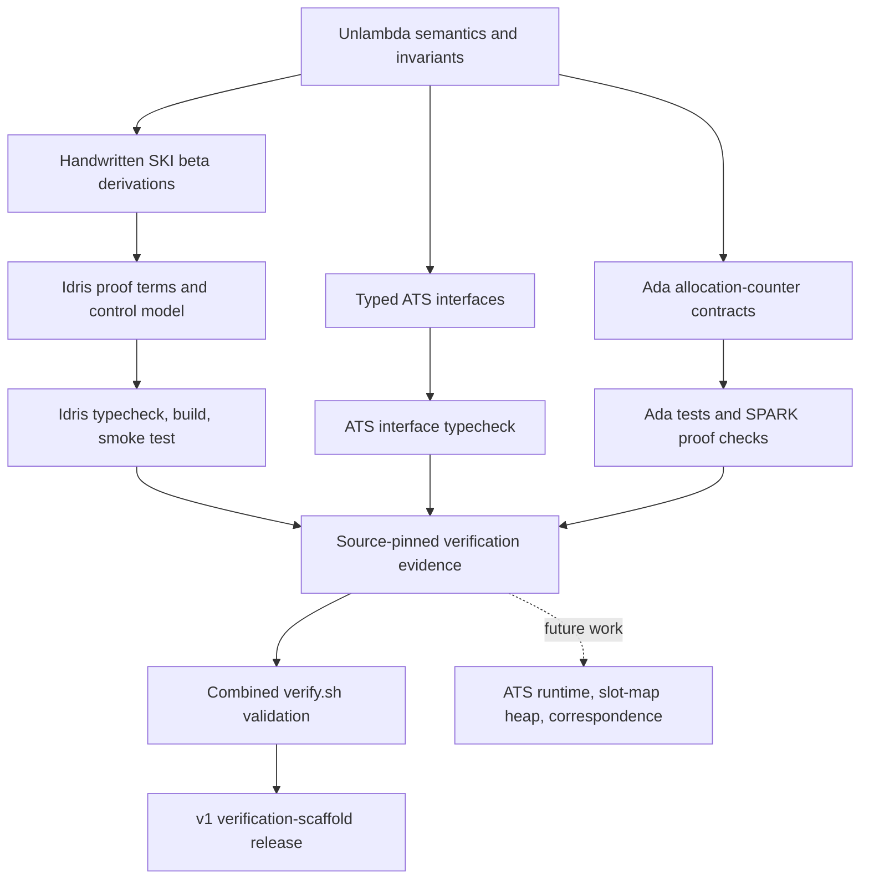

# Unlambda + ATS + Idris 2 + SPARK

**Handwritten lambda-calculus derivations, checked proof terms, and explicit verification boundaries.**

[](https://github.com/AHMADALIPARR/unlambda-idris-spark/actions/workflows/idris-proofs.yml)
[](https://github.com/AHMADALIPARR/unlambda-idris-spark/actions/workflows/ats-spark.yml)
[](https://github.com/AHMADALIPARR/unlambda-idris-spark/releases/tag/v1.0.0)
[](docs/verification/ats-spark-af40c4e.md)
[](SECURITY.md)
[](COMMERCIAL-LICENSING.md)
[](SUPPORT.md)


v1.0.0 packages a verification scaffold for a combined Unlambda/ATS/Idris/SPARK
architecture. It includes compiler-checked ATS interfaces, handwritten SKI
derivations formalized in Idris 2, and a SPARK-proved bounded allocation counter.
The full ATS interpreter, generational heap, and cross-language correspondence
are future work. This release makes the existing evidence easy to reproduce.

## What is checked

| Layer | Current result | Boundary |
| --- | --- | --- |
| ATS/Postiats 0.4.2 | Both `.sats` interfaces typecheck | Runtime implementations and adapter are pending |
| Idris 2 0.8.0 | SKI proof terms and fuel model typecheck | SKI witnesses cover symbolic free atoms; control model is a stub |
| GNAT/Ada | Heap compiles and passes capacity/exhaustion/reset tests | Heap counts allocations; it does not yet store nodes |
| SPARK/GNATprove | Six checks discharged, zero unproved | Current allocation-counter contracts only |
| Combined CI | `verify.sh` passes with all toolchains | Full runtime certification remains open |

The counter badge links a recorded source snapshot. CI badges show the current
branch. [Verification evidence](docs/verification/ats-spark-af40c4e.md) records
the source hashes, versions, proof results, and limitations.

## How the workflow fits together



SPARK verifies the Ada contracts; Idris checks its own proof terms. Agreement
between an ATS runtime, Ada implementation, and Idris semantics will require a
checked adapter and a separate simulation/correspondence argument. See the
[full workflow](docs/WORKFLOW.md) and [delivery backlog](docs/DELIVERY.md).

## Reproduce the checks

Use Linux x86-64 with Bash, GNU grep, ATS/Postiats, Idris 2, GNAT, GPRbuild, and
GNATprove installed. [Toolchain versions and setup](docs/WORKFLOW.md#toolchain-setup)
match the CI configuration.

```sh
gh repo clone AHMADALIPARR/unlambda-idris-spark
cd unlambda-idris-spark
bash verify.sh
```

The repository is private; cloning requires access. A passing run checks the
ATS declarations, typechecks and compiles the Idris model, runs the Ada tests,
and requires GNATprove to discharge the heap checks. The success message names
that component scope explicitly.

## Repository map

| Path | Purpose |
| --- | --- |
| `ats/` | Typed heap and machine interfaces |
| `idris/LambdaProofs.idr` | Explicit beta-reduction witnesses and substitution cases |
| `idris/Main.idr` | Fuel/control model and resource-status proof terms |
| `ada/` | Bounded allocation counter, contracts, assertion-enabled test driver |
| `spec/` | Semantics, invariants, handwritten derivations |
| `docs/verification/` | Recorded compiler and prover evidence |
| `docs/source-sketches/` | Original supplied shorthand interfaces |
| `.github/workflows/` | Idris and ATS/SPARK/combined validation jobs |

## Contribute, report, and support

- [Contributing](CONTRIBUTING.md): meaningful changes, proof obligations, and review criteria.
- [Security](SECURITY.md): private reporting and supported scope.
- [Licensing](LICENSING.md): current licensing status and provenance boundaries.
- [Commercial licensing](COMMERCIAL-LICENSING.md): inquiries and required agreement details.
- [Support and donations](SUPPORT.md): ways to help; payment destination is awaiting confirmation.
- [v1.0.0 release notes](docs/releases/v1.0.0.md) and [changelog](CHANGELOG.md).

The cover and supporting photographs are AI-generated conceptual illustrations,
not proof evidence or screenshots of an implemented interpreter. Image provenance
and the exact generation prompts are in [the asset notes](docs/assets/README.md).
