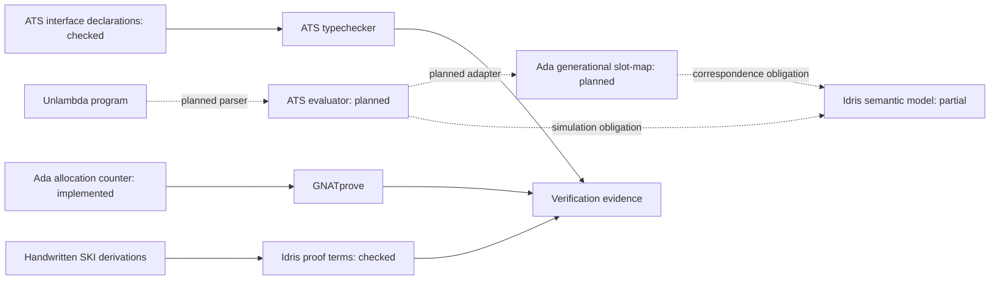
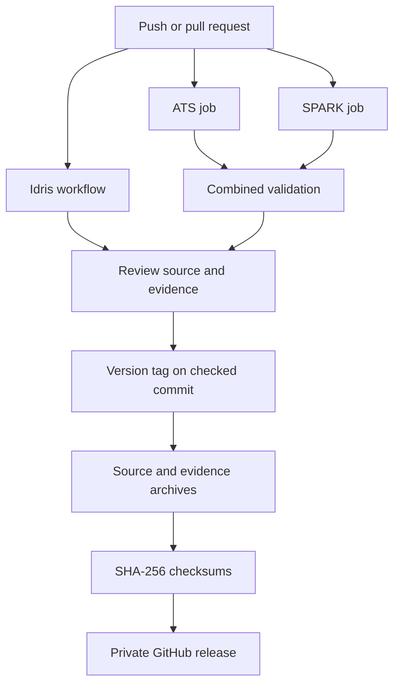

# Development and verification workflow

The project combines three verification layers around the Unlambda language.
Each tool checks a different artifact. Their results become a shared evidence
record; they do not automatically prove one another's implementations.

## From mathematics to checked source

1. Define the dialect, reductions, observable I/O order, resource statuses, and
   heap invariants in `spec/`. The intended dialect is Unlambda 2.0.0.
2. Write the mathematical derivation, including substitutions and intermediate
   terms. Current I/K/S derivations are in `spec/lambda-proofs.md`.
3. Encode the derivation as explicit Idris proof terms. `LambdaProofs.idr` uses
   locally nameless terms, capture-avoiding substitution, and indexed reduction
   witnesses. Current witnesses quantify over symbolic free atoms.
4. Typecheck the proofs with totality checking. Compile and run the current
   fuel/control model. Its output is `step: advanced`; it is not an evaluator.
5. Typecheck the ATS declarations. They describe abstract handles, error results,
   stack frames, control, I/O, fuel, and status. Implementations remain pending.
6. Compile the Ada heap, run assertion-enabled boundary tests, and prove its
   contracts with SPARK. The current heap is a capacity-64 allocation counter.
7. Run the combined validation command and retain the logs for the same source
   snapshot. Reject unproved checks and warnings in the SPARK job.
8. Release the checked component scaffold with versioned source, checksums,
   evidence, and a precise statement of what remains unimplemented.

## Target architecture and current boundary



Solid arrows show existing checked paths. Dotted arrows show planned runtime
paths or outstanding correspondence obligations. There is no AST parser,
continuation evaluator, generation-checked slot-map, or ATS/Ada adapter in v1.


## Continuous integration

`idris-proofs.yml` bootstraps or restores Idris 2 from pinned upstream commit
`15a3e4e70843f7a34100f6470c04b791330788df`. It typechecks `LambdaProofs.idr` and
`Main.idr`, compiles the model, and checks its output.

`ats-spark.yml` has three jobs:

| Job | Checks | Evidence |
| --- | --- | --- |
| `ats` | ATS compiler version and both interface typechecks | `ats-validation-evidence` |
| `spark` | Native compilation, heap boundary tests, strict GNATprove checks | `spark-validation-evidence` |
| `combined` | All toolchains run the repository's `verify.sh` after the first two jobs pass | `combined-validation-evidence` |

The prover distribution is pinned by SHA-256 and cached before project checks.
The proof command uses `--mode=all --checks-as-errors=on --warnings=error
--report=all --level=2`, targeting `heap_model.adb`. The I/O test driver is outside
the SPARK proof boundary. Failures preserve the available reports for diagnosis.



## Toolchain setup

CI's supported host is Ubuntu 24.04, Linux x86-64. The ATS package is
`ats2-lang=0.4.2-1.1`, Idris is 0.8.0, the native compiler is GNAT 13.3.0, and
the checksum-pinned GNATprove distribution is Alire 15.1.0 (reports FSF 15.0).

For a local Linux environment, install ATS, the Ada compiler/build tool, and the
Idris bootstrap dependencies:

```sh
sudo apt-get update
sudo apt-get install -y ats2-lang=0.4.2-1.1 gnat gprbuild chezscheme build-essential libgmp-dev
```

Follow the [official Idris installation instructions](https://github.com/idris-lang/Idris2/blob/15a3e4e70843f7a34100f6470c04b791330788df/INSTALL.md)
for that source commit. GNATprove can be obtained through
[Alire](https://alire.ada.dev/crates/gnatprove); the exact verified archive and
hash are in [the evidence report](verification/ats-spark-af40c4e.md). The workflow
files record the commands used by CI. Ensure `idris2`, `patsopt`, `gprbuild`, and
`gnatprove` are on PATH before running `bash verify.sh`.

The local Windows workspace does not currently have those compiler toolchains;
the passing reports were produced by Linux CI. Native Windows runtime support
has not been established.

## Release and rollback

v1 is a verification-scaffold release. Release assets include source, recorded
evidence, and `SHA256SUMS.txt`. Compare the hash before unpacking an asset and
rerun validation when changing compilers or source.

To reproduce or return to the release source:

```sh
git fetch --tags
git switch --detach v1.0.0
bash verify.sh
```

A future interpreter release must pass the open gates in `DELIVERY.md`: actual
heap safety, all primitives and effects, differential tests, and correspondence.
The v1 tag does not mark those gates complete.
